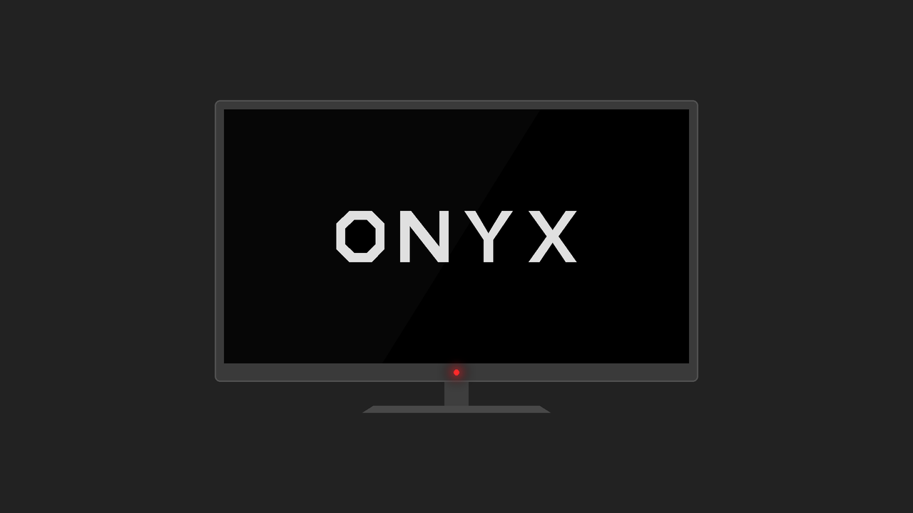
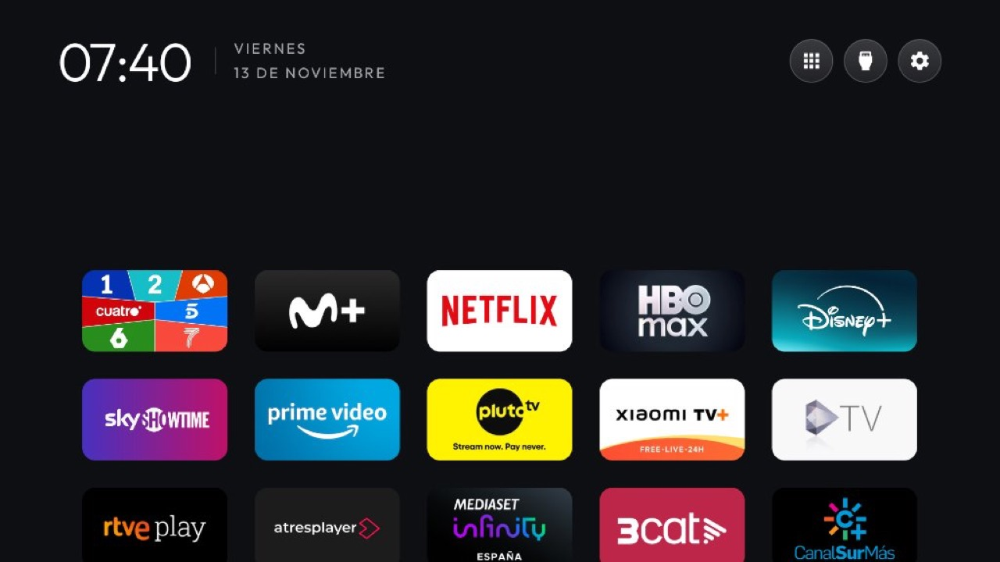
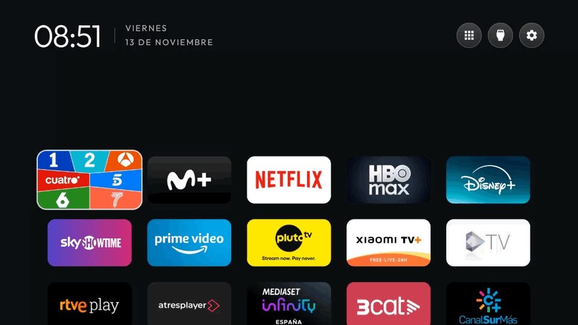

<p align="center">
  
</p>

# Onyx TV Launcher

[English](README.md) · [Español](README.es.md)

**Onyx** es un launcher para Android TV, Google TV y Fire OS (7/8) minimalista, en negro puro y sin distracciones, basado en [Gathin23/cleanyourtv](https://github.com/Gathin23/cleanyourtv). Toda su apariencia base y personalización viven dentro de los ajustes de la app: en Android TV y Google TV estándar está pensado para **instalar y usar**, sin opciones de desarrollador, sin IA y sin archivos `config.json`.



## Características

- **Instalar y usar (`2.1.0+`):** arranca directamente con el diseño minimalista de Onyx (fondo `#0E0F12`, marco de foco fino, cuadrícula de 5 columnas, bóveda de aplicaciones y barra superior solo con iconos), sin depender de temas externos.
- **Identificador propio (`im.marin.onyxtv`):** convive en paralelo con otros lanzadores (`com.gathin.tvhome` o el de fábrica) con icono y banner propios (`img/onyx/`).
- **Ajustes completos en la TV (6 secciones):**
  - **Inicio:** columnas (`4–7`), **Botones superiores** configurables (*Red / Wi-Fi*, *Entradas*, *Ajustes*; *Aplicaciones* siempre visible), fondo personalizado, **Enfocar primera app al iniciar**, entradas en Inicio y **Personalizar entradas** (renombrar, icono/banner 16:9, ocultar).
  - **Bóveda de aplicaciones:** **Personalizar aplicaciones** (renombrar, icono `1:1` y banner `16:9` propios, ocultar de Inicio y Apps, restablecer) manteniendo foco y scroll al fijar/quitar apps de Inicio.
  - **Idioma y reloj:** más de 30 idiomas y formato del reloj (*Sistema / 12 h / 24 h*).
  - **Botones del mando:** aprendizaje en vivo de pulsaciones cortas/largas y captura de ventanas Fire OS para asignar apps, entradas o acciones de Onyx.
  - **Sistema y arranque:** **Volver a Onyx al encender** (Android TV), **Poner Onyx como predeterminado** (Android TV) y **Modo Fire OS** (autodetectado en Fire OS, incluyendo detección automática de TDT en Xiaomi TV / Vewd).
  - **Restablecer ajustes:** restaura la configuración integrada de fábrica.
- **Privacidad total:** sin permiso `INTERNET`; todas las imágenes personalizadas se cargan localmente (`banners/`, `app_icons/`, `app_banners/`).



## Instalación (Android 8.0+ / API 26+)

### Android TV / Google TV (Instalar y usar, sin ADB)

1. Instala **Onyx** (`app-release.apk` desde [Releases](../../releases/latest), F-Droid, USB o LocalSend).
2. Abre **Onyx**, entra en **Ajustes** (icono de engranaje) → **Poner Onyx como predeterminado** y elige **Onyx**.
3. Todo lo demás (columnas, fondo, entradas, ocultar/renombrar apps o mapear teclas) se ajusta directamente con el mando.

> **Importante si vas a usar *Botones del mando* (Netflix, YouTube, Estrella, etc.):**  
> En Android TV, los botones dedicados/globales del fabricante (**Netflix, YouTube, Disney+, Prime Video, teclas estrella/programables, Guía, TV…**) los intercepta el sistema antes de llegar a Onyx. Si al usar **Añadir atajo → *Pulsa el botón del mando*** notas que algunas teclas normales sí las escucha pero esas teclas dedicadas no responden:
> 1. Entra en **Ajustes de Onyx → Botones del mando → Servicio de accesibilidad del mando** (o en los **Ajustes de Android TV → Accesibilidad**).
> 2. En la lista verás dos servicios de Onyx: activa **`Botón Inicio`** (`HomeKeyService`), que es el que permite capturar y remapear esos botones globales en cualquier app, además de habilitar **Apagar o reiniciar** y **Volver a Onyx al encender**. *(El segundo servicio, **`Onyx`** / `InputKeyService`, solo hace falta activarlo si tras deshabilitar el launcher de fábrica deja de funcionar la tecla física **Entrada / Source** del mando).*

---

### Fire OS (Fire TV Stick / Fire TV / Xiaomi TV con Fire OS)

Onyx autodetecta **Fire OS** (**Modo Fire OS**) y la TDT de Xiaomi/Vewd automáticamente, sin necesidad de `config.json`.

> **Limitación de Amazon Fire OS:** Amazon bloquea en el menú gráfico del sistema activar servicios de accesibilidad y cambiar el launcher predeterminado. Por esta restricción de Fire OS, es necesario ejecutar **una sola vez unos comandos por ADB** tras instalar el APK para activar **Botón Inicio (`HomeKeyService`)**. *(Después de ese paso inicial, el resto de ajustes de Onyx se configura directamente desde la tele).*

#### Comandos ADB (una sola vez desde el ordenador)

1. En tu Fire TV / televisor: **Configuración → Mi Fire TV → Opciones para desarrolladores → Depuración ADB: Activado** (y anota la IP de la tele en **Acerca de → Red**).
2. Ejecuta estos comandos en tu ordenador:

```bash
# 1. Conectar por ADB (cambia <IP_TELE> por la IP de tu TV)
adb connect <IP_TELE>:5555

# 2. Instalar Onyx
adb install -r app-release.apk

# 3. Conceder permisos auxiliares para autorecuperación y retorno en Fire OS
adb shell pm grant im.marin.onyxtv android.permission.WRITE_SECURE_SETTINGS
adb shell cmd notification allow_listener im.marin.onyxtv/im.marin.onyxtv.GuardRevival
adb shell settings put global alarm_manager_constants min_futurity=0

# 4. Activar el servicio de accesibilidad de Onyx (respetando otros servicios si ya existían)
adb shell 's=$(settings get secure enabled_accessibility_services | tr -d "\r"); case "$s" in ""|null) n="im.marin.onyxtv/im.marin.onyxtv.HomeKeyService";; *HomeKeyService*) n="$s";; *) n="$s:im.marin.onyxtv/im.marin.onyxtv.HomeKeyService";; esac; settings put secure enabled_accessibility_services "$n"; settings put secure accessibility_enabled 1'

# 5. Abrir Onyx
adb shell am start -W -n im.marin.onyxtv/.MainActivity
```

#### Comprobación rápida

```bash
adb shell "dumpsys accessibility | grep -E 'HomeKeyService|Botón Inicio'"
```

Debe aparecer `Service[label=Botón Inicio, ...]`. A partir de ese momento, al pulsar el botón **Inicio** volverás siempre a **Onyx**.

#### Prompt lista para usar con un asistente / IA con terminal

Si prefieres que una IA o agente de terminal haga ese paso por ti automáticamente:

> *Conéctate por `adb` a mi televisor Fire OS en `<IP_TELE>:5555`, instala `app-release.apk`, concede `android.permission.WRITE_SECURE_SETTINGS` y permiso de notificaciones a `im.marin.onyxtv/im.marin.onyxtv.GuardRevival`, ajusta `alarm_manager_constants min_futurity=0`, añade `im.marin.onyxtv/im.marin.onyxtv.HomeKeyService` a `enabled_accessibility_services` sin borrar servicios previos, activa `accessibility_enabled=1`, inicia `im.marin.onyxtv/.MainActivity` y verifica que `Botón Inicio` aparece activo en `dumpsys accessibility`.*

---

## Compilar desde el código fuente

```bash
TV_HOST=<ip-de-la-tele> tools/install.sh
```

O en Windows (PowerShell):

```powershell
$env:TV_HOST = "<ip-de-la-tele>"
.\tools\install.ps1
```

## Créditos

Basado en [CleanYourTV](https://github.com/Gathin23/cleanyourtv) de Gathin23. Licencia MIT — ver [LICENSE](LICENSE).
