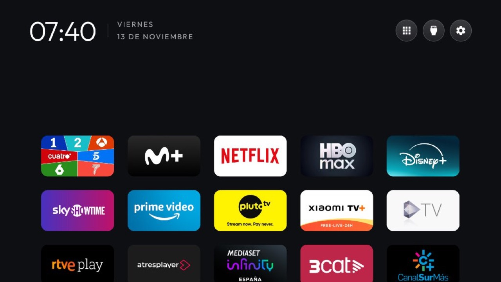

# Onyx TV Launcher

**Onyx** is a pure-dark, distraction-free Android TV / Google TV launcher and theme fork based on [Gathin23/cleanyourtv](https://github.com/Gathin23/cleanyourtv).



## Features

- **Pure Dark Canvas (`#0E0F12`):** Zero wallpaper noise, zero ambient glow, ideal for OLED and high-contrast TVs.
- **5-Column Minimalist Home:** Adjustable `dock_margin_top` (`145`), `focus_scale` (`1.25x`), rim-only focus highlight (`glass_style: "rim"`), and optional silent startup (`initial_focus: false`).
- **6-Column App Library Grid:** Clean grid app drawer (`AppLibraryDialog`) with on-home indicator and context menu on long-press OK.
- **Icon-Only Top Toolbar:** Floating icon-only controls (App Library, Inputs, Settings) without extra pills or clutter.
- **Multi-Language:** Inherits full 30+ language support from CleanYourTV (English, Spanish, German, French, Italian, Portuguese, Dutch, Polish, Ukrainian, Turkish, Japanese, Chinese, etc.).

## Installation

### 1. Build & Install Launcher (Android 8.0+ / API 26+)

```bash
TV_HOST=<tv-ip> tools/install.sh
```

Or on Windows (PowerShell):

```powershell
$env:TV_HOST = "<tv-ip>"
.\tools\install.ps1
```

### 2. Apply the Onyx Theme

```bash
TV_HOST=<tv-ip> tools/theme.sh themes/onyx
```

To reset back to defaults:

```bash
TV_HOST=<tv-ip> tools/theme.sh --reset
```

## Credits

Built on top of [CleanYourTV](https://github.com/Gathin23/cleanyourtv) by Gathin23. MIT License — see [LICENSE](LICENSE).
