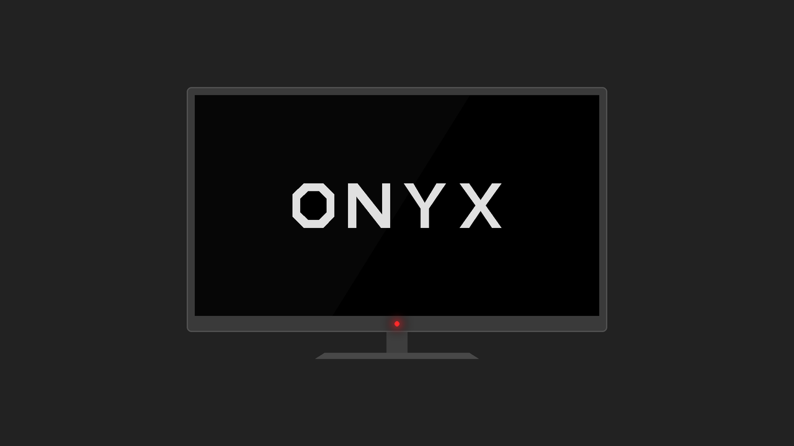
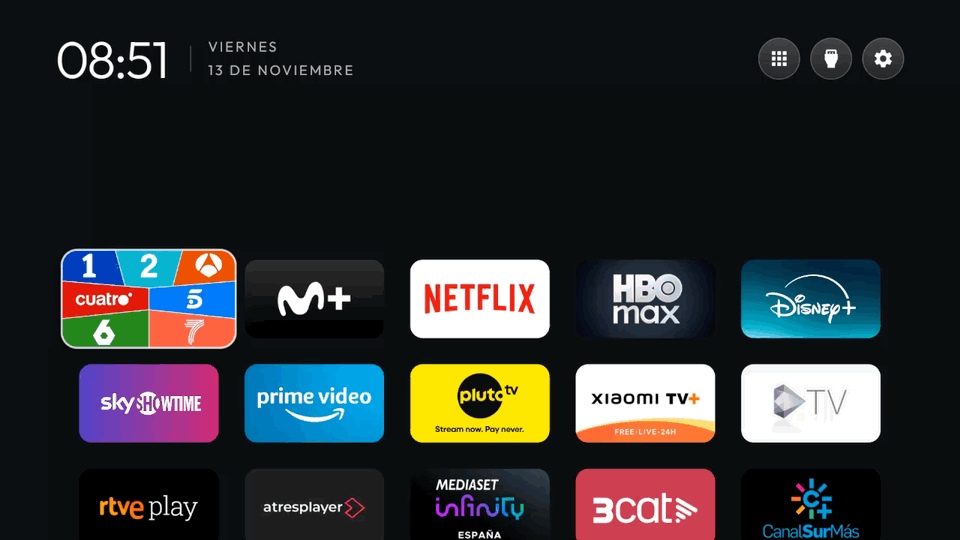

<p align="center">
  
</p>

# Onyx TV Launcher

[English](README.md) · [Español](README.es.md)

**Onyx** is a pure-dark, plug-and-play Android TV, Google TV, and Fire OS (7/8) launcher based on [Gathin23/cleanyourtv](https://github.com/Gathin23/cleanyourtv). All core Onyx visual defaults and customization live inside the TV settings UI — no developer tools, AI prompts, or `config.json` files are required on standard Android TVs.


## Features

- **Plug & Play Defaults (`2.1.0+`):** Launches directly with the minimalist `#0E0F12` dark canvas, rim-only focus highlight, 5-column uniform grid, 6-column app library, and icon-only toolbar — zero external theme files required.
- **Independent Package Identity (`im.marin.onyxtv`):** Coexists cleanly alongside other launchers (`com.gathin.tvhome`, stock OEM launchers) with custom app icon and TV banner (`img/onyx/`).
- **6-Section On-TV Settings UI:**
  - **Home:** Grid columns (`4–7`), customizable top-bar buttons (Network, Inputs, Settings; App Library always kept), custom wallpaper, silent/initial focus toggle, inputs on Home selector, and **Customize inputs** (`rename`, custom 16:9 banners, hide).
  - **App Library:** **Customize apps** (rename, custom `1:1` icon & `16:9` banner, hide from Home & App Library, reset) with focus & scroll preserved when pinning/unpinning from Home.
  - **Language & Clock:** 30+ languages and System / 12h / 24h clock format.
  - **Remote Keys:** Interactive shortcut learning (`KeyEvent` + Fire OS window launch capture) for apps, inputs, and Onyx actions.
  - **System & Power:** **Return to Onyx on power-on** (Android TV), **Set Onyx as default** (Android TV), and **Fire OS mode** (auto-detected on Fire OS, including Xiaomi/Vewd Live TV tuner detection).
  - **Reset:** One-click reset to built-in defaults.
- **Zero `INTERNET` Permission:** Purely offline with local artwork import (`banners/`, `app_icons/`, `app_banners/`).



## Installation (Android 8.0+ / API 26+)

### Android TV / Google TV (Install & Use — no ADB required)

1. Install `Onyx` (`app-release.apk` from [Latest Release](../../releases/latest) or via F-Droid / USB / LocalSend).
2. Open **Onyx**, go to **Settings** (gear icon) → **Set Onyx as default** (*Poner Onyx como predeterminado*), and select **Onyx**.
3. Everything else (columns, wallpaper, apps, inputs, remote shortcuts) can be configured directly with your remote.

> **Important when using *Remote buttons* (Netflix, YouTube, Star/programmable keys, etc.):**  
> On Android TV, dedicated OEM/global buttons (**Netflix, YouTube, Disney+, Prime Video, Star/programmable buttons, Guide, TV…**) are intercepted by the system before reaching app dialogs. If **Add shortcut → *Press remote button*** hears regular keys but ignores those dedicated buttons:
> 1. Open **Onyx Settings → Remote buttons → Remote accessibility service** (or Android TV **Settings → Accessibility**).
> 2. You will see two Onyx entries: enable **`Home button` / `Botón Inicio`** (`HomeKeyService`), which handles live capture and global shortcuts across all apps, as well as **Power off or restart** and **Return to Onyx on power-on**. *(The second entry, **`Onyx`** / `InputKeyService`, is only needed if disabling the stock launcher stops your remote's physical **Input / TV** key from opening the input switcher).*

---

### Fire OS (Fire TV Stick / Fire TV / Xiaomi TV with Fire OS)

Onyx automatically detects **Fire OS** (`Modo Fire OS`) and Xiaomi/Vewd Live TV tuners without needing any `config.json`.

> **Amazon Fire OS limitation:** Amazon blocks enabling Accessibility services and changing the default launcher from the TV's Settings UI. Because of this platform restriction, Fire OS devices require **one initial ADB setup** after installing the APK so **Botón Inicio (`HomeKeyService`)** can intercept the Home button and remote shortcuts. *(Every other Onyx setting still works directly from the TV UI afterward.)*

#### Step-by-step ADB commands (run once from a computer)

1. On the Fire TV / TV: **Settings → My Fire TV → Developer Options → ADB Debugging: ON** (and note the TV IP in **About → Network**).
2. Run these commands on your computer:

```bash
# 1. Connect to your TV (replace with your TV IP)
adb connect <TV_IP>:5555

# 2. Install Onyx APK
adb install -r app-release.apk

# 3. Grant helper permissions for self-recovery & Fire OS wake handling
adb shell pm grant im.marin.onyxtv android.permission.WRITE_SECURE_SETTINGS
adb shell cmd notification allow_listener im.marin.onyxtv/im.marin.onyxtv.GuardRevival
adb shell settings put global alarm_manager_constants min_futurity=0

# 4. Enable Onyx Accessibility service (preserving any existing services if present)
adb shell 's=$(settings get secure enabled_accessibility_services | tr -d "\r"); case "$s" in ""|null) n="im.marin.onyxtv/im.marin.onyxtv.HomeKeyService";; *HomeKeyService*) n="$s";; *) n="$s:im.marin.onyxtv/im.marin.onyxtv.HomeKeyService";; esac; settings put secure enabled_accessibility_services "$n"; settings put secure accessibility_enabled 1'

# 5. Launch Onyx
adb shell am start -W -n im.marin.onyxtv/.MainActivity
```

#### Quick verification

```bash
adb shell "dumpsys accessibility | grep -E 'HomeKeyService|Botón Inicio'"
```

You should see `Service[label=Botón Inicio, ...]` listed. Once bound, pressing the **Home** button will always keep **Onyx** on top.

#### Optional prompt for an AI assistant / terminal agent

If you prefer an AI coding/terminal assistant to perform the Fire OS step automatically:

> *Connect to my Fire OS TV at `<TV_IP>:5555` via `adb`, install `app-release.apk`, grant `android.permission.WRITE_SECURE_SETTINGS` and notification listener access (`im.marin.onyxtv/im.marin.onyxtv.GuardRevival`), set `alarm_manager_constants min_futurity=0`, append `im.marin.onyxtv/im.marin.onyxtv.HomeKeyService` to `enabled_accessibility_services` without removing any existing services, set `accessibility_enabled=1`, launch `im.marin.onyxtv/.MainActivity`, and verify `Botón Inicio` is bound in `dumpsys accessibility`.*

---

## Build from Source

```bash
TV_HOST=<tv-ip> tools/install.sh
```

Or on Windows (PowerShell):

```powershell
$env:TV_HOST = "<tv-ip>"
.\tools\install.ps1
```

## Credits

Built on top of [CleanYourTV](https://github.com/Gathin23/cleanyourtv) by Gathin23. MIT License — see [LICENSE](LICENSE).
